 

  <picture>
    <source media="(prefers-color-scheme: dark)" srcset="assets/banner-dark.svg">
    <source media="(prefers-color-scheme: light)" srcset="assets/banner-light.svg">
    
  </picture>

<!-- Animated professional tagline -->

  <picture>
    <source
      media="(prefers-color-scheme: dark)"
      srcset="https://readme-typing-svg.demolab.com?font=JetBrains+Mono&amp;weight=600&amp;size=22&amp;duration=3000&amp;pause=1200&amp;color=69B9FF&amp;center=true&amp;vCenter=true&amp;width=950&amp;height=55&amp;lines=Mathematician+%7C+Data+Scientist+%7C+ML+%26+AI%3BMathematical+Optimisation+%7C+Simulation+%7C+Data+Engineering%3BExploring+Patterns.+Modelling+Complexity."
    />
    <source
      media="(prefers-color-scheme: light)"
      srcset="https://readme-typing-svg.demolab.com?font=JetBrains+Mono&amp;weight=600&amp;size=22&amp;duration=3000&amp;pause=1200&amp;color=126AAE&amp;center=true&amp;vCenter=true&amp;width=950&amp;height=55&amp;lines=Mathematician+%7C+Data+Scientist+%7C+ML+%26+AI%3BMathematical+Optimisation+%7C+Simulation+%7C+Data+Engineering%3BExploring+Patterns.+Modelling+Complexity."
    />
    
  </picture>

## About Me

Hi, I'm **Giusseppe Bervis**, a mathematician from Nicaragua , currently based in Valencia, Spain , with an M.Sc. in Mathematics and Computing from the University of Cantabria.

My interests lie at the intersection of **applied mathematics, scientific computing, data science, and machine learning**. I enjoy understanding complex problems, exploring their mathematical foundations, and developing computational approaches to solve them.

My background includes mathematical optimisation, stochastic simulation, and numerical methods. I am also expanding my work towards data engineering, reproducible computational workflows, and AI.

I believe that understanding a problem is just as important as finding a solution.

$$
\text{Curiosity} + \text{Rigour} + \text{Computation}
\longrightarrow \text{Understanding}
$$

### Areas of Interest

- **Mathematical Optimisation:** Multi-objective optimisation, metaheuristics, and computational algorithms.
- **Probability & Simulation:** Stochastic modelling, statistical analysis, and Monte Carlo methods.
- **Data Science & Engineering:** Data analysis, databases, data pipelines, and reproducible workflows.
- **Machine Learning & AI:** Statistical learning, neural networks, and mathematical foundations of intelligent systems.
- **Applied Research:** Connecting mathematical ideas with practical problems, including industrial applications.

---

## 🛠️ Technical Stack

  <strong>Programming Languages</strong>

  
  
  

  <strong>Scientific Computing & Data Analysis</strong>

  
  
  
  

  <strong>Machine Learning & Deep Learning</strong>

  
  

  <strong>Databases & SQL</strong>

  
  
  

  <strong>Development Tools & Environments</strong>

  
  
  
  
  
  

---

## Currently Exploring

My learning and development interests currently include:

- **Data Engineering:** end-to-end pipelines, data modelling, orchestration and reproducible infrastructure.
- **Advanced Machine Learning:** deep learning, graph neural networks and mathematical approaches to model design.
- **Scientific & Industrial Computing:** optimisation, simulation and data-driven modelling of industrial processes.

---

## GitHub Activity

  <!-- GitHub Statistics -->
  <picture>
    <source
      media="(prefers-color-scheme: dark)"
      srcset="https://github-readme-stats.vercel.app/api?username=gbervis&amp;show_icons=true&amp;theme=tokyonight&amp;hide_border=true"
    />
    <source
      media="(prefers-color-scheme: light)"
      srcset="https://github-readme-stats.vercel.app/api?username=gbervis&amp;show_icons=true&amp;theme=default&amp;hide_border=true"
    />
    
  </picture>

  <!-- Most Used Languages -->
  <picture>
    <source
      media="(prefers-color-scheme: dark)"
      srcset="https://github-readme-stats.vercel.app/api/top-langs/?username=gbervis&amp;layout=compact&amp;theme=tokyonight&amp;hide_border=true"
    />
    <source
      media="(prefers-color-scheme: light)"
      srcset="https://github-readme-stats.vercel.app/api/top-langs/?username=gbervis&amp;layout=compact&amp;theme=default&amp;hide_border=true"
    />
    
  </picture>

---

## Let's Connect

I'm always interested in discussing mathematical modelling, optimisation, data science, machine learning, and the application of computational methods to real-world problems.

  
  

  <em> Driven by curiosity. Grounded in mathematics. Always learning. </em>

